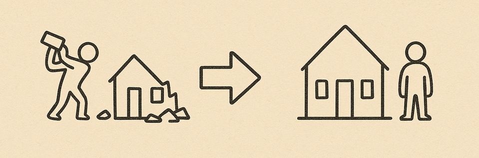

::: {#about-me}
## Hi, I'm Simran

I'm a statistician who wants to build a career as a researcher in applied probability. I completed my Master's in Statistics at McMaster University in 2026 under the supervision of [Dr. Pratheepa Jeganathan](https://experts.mcmaster.ca/display/jeganp1), and I'm now applying to PhD programs in statistics.

::: lead-box
**Research interests:** applied probability, particularly the ideas behind computational statistics and Bayesian nonparametrics. I hope to learn new concepts, develop my own, and encounter many more during a PhD.
:::

## Research

#### Continuity of measure in uncountable unions

My first experience of mathematical research started with a question I asked [Dr. Noah Forman](https://experts.mcmaster.ca/display/formann): does continuity of measure extend to uncountable unions of measurable sets? He conjectured that it holds for increasing families with an upper bound, then found a counterexample. I developed the proofs, learned the new mathematics the problem demanded, and formulated my own conjecture while exploring possible generalizations. The resulting paper, [*Counterexample to Continuity of Measure in Uncountable Unions*](https://doi.org/10.1016/j.exco.2026.100231), has been accepted in *Examples and Counterexamples*.

More importantly, this project showed me how much I enjoy theoretical work: developing rigorous arguments, understanding the ideas underneath them, and finding the next question to ask.

#### Sparsity and identification in Bayesian factor models

My [Master's thesis](https://macsphere.mcmaster.ca/items/c0d49046-d501-47f7-a8e7-f9d782084979) studied how sparsity from shrinkage priors interacts with structural identification constraints in Bayesian factor models. The goal was to recover the number of latent factors and the loading structure in high-dimensional settings with many irrelevant variables, motivated by the problem of uncovering latent structure in transformed microbiome data.

The main computational challenge was sampling the factor loadings and latent factors, whose conditional posteriors are strongly dependent. I developed a parameter expansion step for the MCMC sampler that introduces scaling parameters for the loadings and factors. With inverse-gamma priors on these scales, I showed that their conditional posteriors are generalized inverse Gaussian, so they can be sampled efficiently. I later rewrote the sampler in C++ and extended our simulations to settings with more variables than observations, where the UGLT structure gave the best predictive performance.

I presented this work at the [2026 Statistical Society of Canada Annual Meeting](https://ssc.ca/en/meeting/annual/presentation/a-comparative-study-bayesian-factor-models-under-positive-lower), and we plan to submit it to *Computational Statistics and Data Analysis*. This project taught me how to think about applied problems and gave me practical skills in simulation design and computational efficiency.

## Learning and Teaching

Two graduate courses shaped my interests most. [Dr. Shui Feng](https://experts.mcmaster.ca/display/shuifeng)'s Bayesian Nonparametrics course was built around the Dirichlet process. We would study a property of the Dirichlet distribution and see how it leads to a construction of the process: gamma random variables give the gamma construction, the Pólya urn gives a construction through de Finetti's theorem, and the beta decomposition gives the stick-breaking representation, which connects to the Chinese restaurant process through the GEM distribution. Seeing one object built in several ways, with each construction revealing a different side of it, is exactly the kind of mathematics I want to spend my time on.

In Dr. Forman's stochastic processes course, students delivered the lectures. I taught a set of [lectures on martingales](pages/CV/files/Probability_and_Stochastics/martingales_intro_notes.pdf) and their relationships to Markov, Wiener, and Poisson processes, including an introduction to stochastic kernels. Preparing them forced me to know the material well enough to answer any question my classmates asked, and I found I enjoyed helping them as much as deepening my own understanding. I've also worked as a teaching assistant for three statistics courses, from first-year help sessions to grading upper-year probability proofs.

## How I Learn

I love learning with a reckless abandon. I like breaking complex concepts down and understanding them right from the ground up. If I had to build a house without knowing how, I would start by finding one (preferably abandoned) and taking it apart.

Why statistics? Truth be told, part of it, like all decisions, was chance (I'm going to refrain from making a probability joke here). I happened to stumble across a field with such depth that it keeps amazing me the further I go, and one where I can grow both by challenging myself mathematically and by improving as a programmer.

## What's Next

I want to do a PhD to learn new concepts, develop my own, and share that knowledge with others. Afterwards, I plan to pursue a faculty career where I can continue research in applied probability and teach alongside it.

In the meantime, I'm working full-time as a Risk Analyst at goeasy, where I test how machine learning risk models hold up when data goes missing.

## Contact Me

The best way to reach me is by e-mail at [1simranbilkhu\@gmail.com](mailto:1simranbilkhu@gmail.com). You can also find me on [GitHub](https://github.com/simb2) and [LinkedIn](https://www.linkedin.com/in/simran-b-8974bb124/), or read my full [CV](pages/CV/files/CV%20(November2026).pdf).
:::
